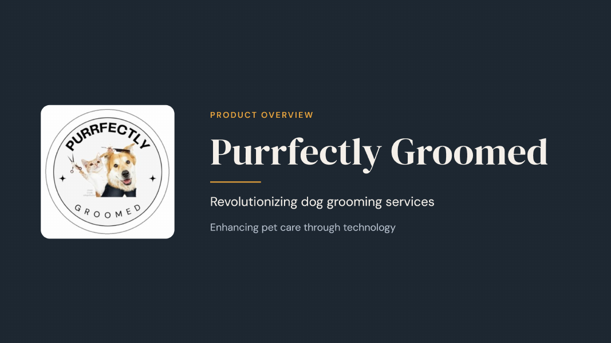

## Presentation

The team's final capstone presentation for the NextGen ServiceNow program (2024).

**[View the full presentation (PDF, 18 slides)](Purrfectly-Groomed-PRESENTATION.pdf)**

The deck covers:
- The team and how we worked as a web development team
- Industry challenges the app was designed to address
- Five core features: automated scheduling and groomer pairing, groomer profiles, notifications and progress tracking, pricing by dog size and coat type, and educational resources
- Roadmap and lessons learned
